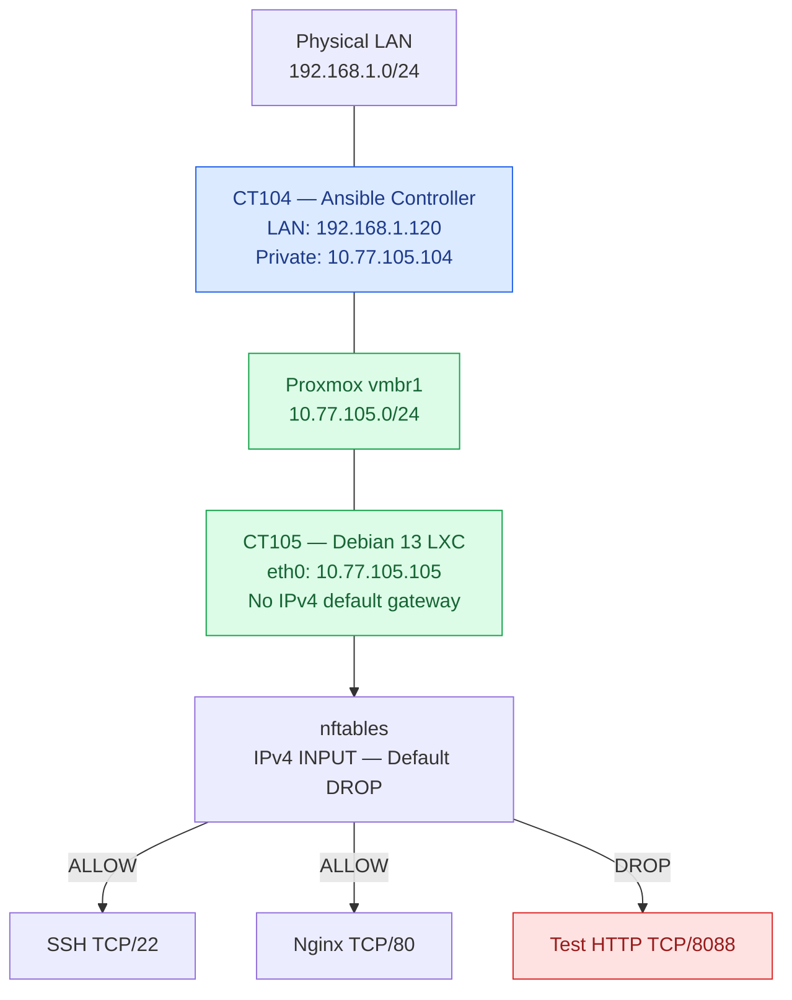

# Project 002 — Network Segmentation & Firewall Engineering

**Infrastructure Engineer Challenge | Week 2**

A hands-on infrastructure security project using **Proxmox VE, Debian 13, Ansible, nftables, and systemd**.

## Overview

Designed and tested a temporary default-deny IPv4 firewall on an isolated Linux container, with controlled management access and scheduled recovery.

### Objectives

- Isolate a Linux workload using a private Proxmox bridge
- Manage the isolated workload centrally through Ansible
- Apply least-privilege inbound firewall rules
- Preserve authorized SSH and HTTP connectivity
- Demonstrate blocking of unauthorized TCP traffic
- Implement and verify timed firewall rollback
- Document results and limitations for reproducibility

**Project status:** Live enforcement testing completed. The experimental firewall was removed after testing.

## 1. Network Architecture



CT104 is dual-homed, connecting to both the physical LAN and the private management network.

CT105 has its own virtual `eth0` interface connected to `vmbr1`. It has **no direct physical LAN uplink and no IPv4 default gateway**.

All CT105 administration in this project was performed through Ansible from CT104.

See [Network Topology](docs/network-topology.md).

## 2. Security Design

### Network segmentation

The private Proxmox bridge separates CT105 from the physical LAN at the network interface level.

Without an IPv4 default gateway, CT105 has no ordinary IPv4 route to destinations outside its directly connected subnet.

This does not, by itself, prove isolation from every possible network path.

### Least-privilege firewall

The experimental nftables configuration uses:

- Dedicated `table ip ct105_lab`
- IPv4 input base chain at priority `10`
- Default `DROP` policy
- Explicit management allowlist
- Connection tracking for established and related traffic

### Docker compatibility

The experiment uses a separate nftables table and does not flush the existing ruleset.

Docker-managed forwarding and NAT tables were not intentionally modified.

### Scope

The experimental policy filters IPv4 input traffic. IPv6, forwarded traffic, and persistent boot-time enforcement were outside the tested scope.

## 3. Access Policy

| Source | Destination | Service | Policy |
|---|---|---|---|
| CT104 | CT105 | SSH TCP/22 | ALLOW |
| CT104 | CT105 | HTTP TCP/80 | ALLOW |
| CT104 | CT105 | ICMP | ALLOW |
| CT104 | CT105 | Test TCP/8088 | DROP |
| Other IPv4 sources | CT105 | Unmatched input | DROP by policy |

The TCP rules were tested from CT104. The last row describes configured policy, not independently tested traffic from other sources.

See [Access Matrix](docs/access-matrix.md).

## 4. Automation Workflow

1. Audit interfaces, routes, listeners, and firewall state.
2. Document the existing network boundaries.
3. Validate the nftables configuration with Ansible.
4. Verify the experimental table is absent.
5. Prepare and verify the rollback script.
6. Schedule a transient systemd rollback timer.
7. Activate the experimental firewall.
8. Verify allowed and denied TCP connections.
9. Confirm restoration of connectivity after rollback.
10. Stop the temporary test listener.

The deployment was intentionally temporary and was not configured to persist after reboot.

## 5. Validation Results

A temporary HTTP listener on TCP/8088 was used as a controlled negative-test target.

| Test | Before firewall | During firewall | After rollback |
|---|---|---|---|
| SSH TCP/22 | Open | Open | Not retested |
| HTTP TCP/80 | HTTP 200 | HTTP 200 | Not retested |
| TCP/8088 | Open | Timed out | Open |
| Experimental firewall table | Absent | Present | Absent |

After stopping the temporary listener, TCP/8088 returned `Connection refused`.

**Enforcement playbook:** `ok=11`, `changed=2`, `failed=0`, `unreachable=0`.

This demonstrates that the experimental policy blocked a previously reachable service while preserving tested management access.

See [Validation Evidence](evidence/validation-results.md).

## 6. Rollback Strategy

Before activation, Ansible scheduled a transient systemd timer to remove the experimental firewall table.

The rollback targeted only `table ip ct105_lab`, avoiding a full nftables ruleset flush.

After the scheduled rollback window:

- The experimental table was absent.
- TCP/8088 was reachable again.
- The transient timer was no longer listed.

The rollback service's execution journal was not retained, so its exact execution history was not independently captured.

The observed state was consistent with successful scheduled recovery.

See [Rollback Procedure](docs/rollback-procedure.md).

## 7. Engineering Lessons

**Validate behavior, not just syntax.** A valid nftables file does not prove the intended network behavior.

**Establish a baseline before testing denial.** TCP/8088 was confirmed open before firewall activation, making its subsequent timeout meaningful.

**Protect the management path.** SSH and HTTP remained reachable during enforcement.

**Avoid interfering with managed infrastructure.** A dedicated experimental table avoided modifying Docker-managed forwarding and NAT rules.

**Verify recovery independently.** Actual firewall state and restored connectivity are stronger evidence than a service status alone.

## 8. Limitations and Future Improvements

This project demonstrates a controlled laboratory experiment, not a production-ready firewall deployment.

Potential improvements:

- Persistent, reboot-safe firewall configuration
- Idempotent Ansible deployment and cleanup
- Unique systemd rollback unit names
- Persistent rollback execution logs
- Stronger post-deployment health checks
- IPv6 policy and validation
- Testing from additional source networks
- Formal forwarding and routing isolation tests

## 9. Repository Structure

```text
02-network-segmentation/
├── README.md
├── ansible/
├── firewall/
│   └── ct105.nft
├── docs/
│   ├── network-topology.md
│   ├── access-matrix.md
│   └── rollback-procedure.md
└── evidence/
    └── validation-results.md
```

## Outcome

Successfully demonstrated temporary IPv4 firewall enforcement on an isolated Debian LXC container, preserving authorized management access while blocking an otherwise reachable TCP service.

The experimental firewall was subsequently removed, and the previously blocked connection became reachable again.

**Technologies:** Proxmox VE · Debian 13 · Linux Networking · Ansible · nftables · systemd · SSH · Docker
