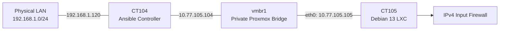

# Network Topology and Trust Boundaries

## Architecture

## Components

| Component | Address | Role |
|---|---|---|
| Physical LAN | 192.168.1.0/24 | Existing management-side network |
| CT104 | 192.168.1.120 | LAN-facing management interface |
| CT104 | 10.77.105.104 | Private management interface |
| vmbr1 | 10.77.105.0/24 | Private virtual network |
| CT105 eth0 | 10.77.105.105/24 | Isolated managed workload |

## Network Design

CT104 is dual-homed and connects to both the physical LAN and private Proxmox bridge.

CT105 has its own virtual `eth0` connected to `vmbr1`. It is not borrowing CT104's network interface.

CT105 has no IPv4 default gateway and no direct physical LAN uplink.

Management access is provided through Ansible over the private network.

## Trust Boundaries

### Physical LAN to private network

CT104 is the management endpoint that can reach CT105 over the private subnet.

CT104's presence on both networks does not automatically mean it forwards traffic between them. Forwarding and routing behavior must be verified separately.

### Private network to CT105 services

The experimental firewall restricts IPv4 input traffic using a default-deny policy.

Only explicitly permitted management traffic is allowed by the experimental chain.

### Docker networking

Docker maintains its own networking and firewall rules.

The experiment does not alter Docker-managed NAT or forwarding tables.

## Isolation Limitations

- No comprehensive inter-network routing test was performed.
- IPv6 filtering was not part of the experiment.
- The tested firewall was temporary.
- No claim is made that every possible network path was blocked.

## Design Rationale

Separating management access from the physical LAN provides a controlled environment for testing restrictive firewall rules without directly modifying production game or media containers.
